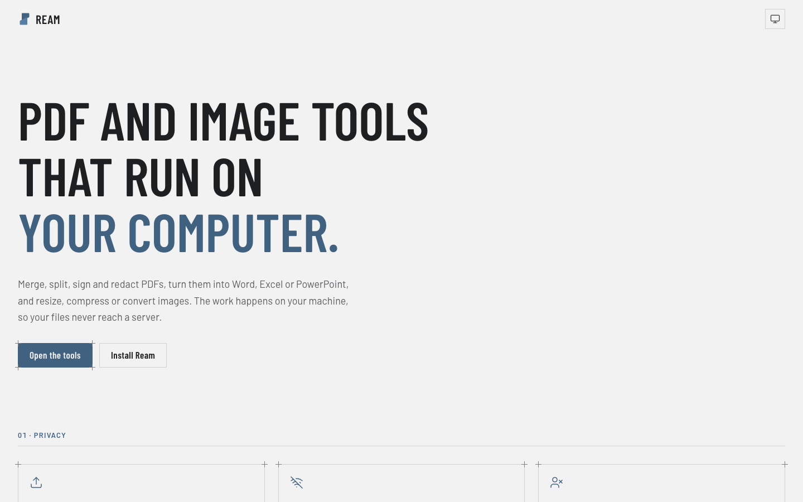
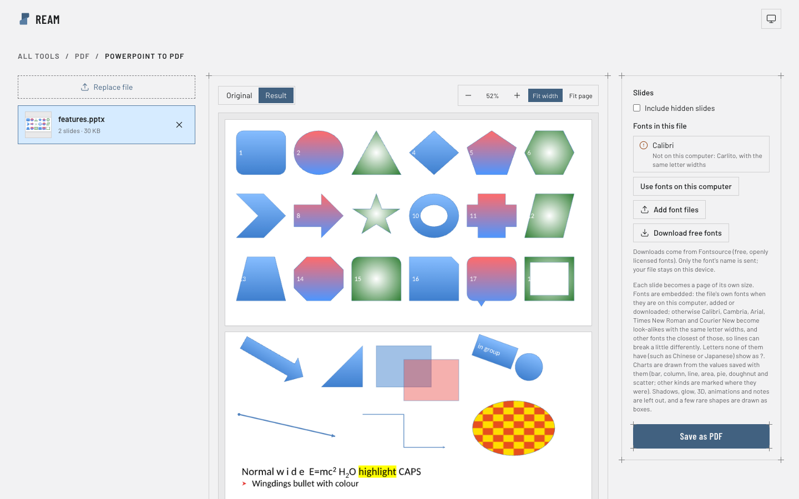

# Ream

**PDF and image tools that run on your computer.** Merge, split, sign, redact and edit PDFs, turn them into Word, Excel or PowerPoint and back, and resize, compress or convert images, all in your browser. Your files are opened and processed on your own device and never reach a server. No account, no uploads, no trackers, and it works offline.

**Use it at [ream.deityhub.com](https://ream.deityhub.com).**

<picture>
  <source media="(prefers-color-scheme: dark)" srcset="docs/images/landing-dark.png">
  
</picture>

<picture>
  <source media="(prefers-color-scheme: dark)" srcset="docs/images/tool-dark.png">
  
</picture>

## What it does

- **PDF:** merge, split, organize pages, compress, crop, page numbers, watermark, sign, fill forms, redact, edit text, pictures and form fields, bookmarks, metadata, protect and unlock, repair, extract images, PDF to text.
- **Conversions:** PDF to Word, Excel, PowerPoint and images; Excel, PowerPoint and images to PDF.
- **Images:** resize, compress, convert, crop, rotate and flip, merge, blur or hide parts, filters, watermark, photo metadata, animated GIFs, memes.

Everything runs in the page, on Ream's own engines (PDF parser, writer and renderer, image codecs, Office readers), with no server behind them. The one network request Ream can make is **Download free fonts**, which sends font names only, when you click it. [docs/limits.md](docs/limits.md) says honestly what is approximate or not supported yet.

## Installation

**In the browser:** open [ream.deityhub.com](https://ream.deityhub.com). Nothing to install.

**As an app:** Ream installs from the browser and then opens in its own window, with no connection needed after the first visit.

- Chrome or Edge: click **Install Ream** on the home page (or the install icon in the address bar).
- Safari on a Mac: File → Add to Dock.
- iPhone or iPad: Share → Add to Home Screen.
- Firefox can't install sites as apps, but Ream still works offline there after one visit.

**With Docker:** run your own copy, for example on a company network.

```bash
docker run --rm -p 8080:8080 ghcr.io/deityhub/ream
```

Then open http://localhost:8080. The image is also on Docker Hub as `deityhub/ream`. Behind HTTPS (your usual proxy), it installs as an app and works offline the same way. See [docs/deploy.md](docs/deploy.md#docker).

**From the source:** you need Node 22 and Yarn 4 (`corepack enable` provides it).

```bash
git clone https://github.com/Deityhub/ream.git
cd ream
corepack enable
yarn install
```

## Running

```bash
yarn dev                             # the app with live reload, on http://localhost:5173
yarn build                           # the production site, in apps/web/dist
yarn workspace @ream/web preview     # serve that build on http://localhost:4173 (offline app included)
yarn test                            # the tests
yarn typecheck                       # TypeScript
docker build -t ream . && docker run --rm -p 8080:8080 ream   # the production site in a container
```

The production site is a folder of static files: any web server can serve `apps/web/dist`. `apps/web/public/_headers` has the response headers it should send (Cloudflare Pages reads it as it is).

## Contributing

Contributions are welcome. Branch from `dev`, open a pull request into `dev`, and make sure `yarn typecheck`, `yarn test` and `yarn build` pass; the pipeline checks the same on every pull request and links a preview of your change. Ream keeps a few firm rules: nothing leaves the user's device, its engines have no runtime dependencies, and everything shipped is MIT-compatible.

[CONTRIBUTING.md](CONTRIBUTING.md) has the details, and [AGENTS.md](AGENTS.md) is the full guide to the code. More in [docs/](docs): the [roadmap](docs/roadmap.md), the [known limits](docs/limits.md), the [design](docs/design.md), and [deploys and releases](docs/deploy.md).

## Licence

Ream is released under the [MIT licence](LICENSE). The software and fonts it ships from others (React, the Lucide icon shapes and the bundled fonts) keep their own licences, listed in [THIRD-PARTY-NOTICES.md](THIRD-PARTY-NOTICES.md).
